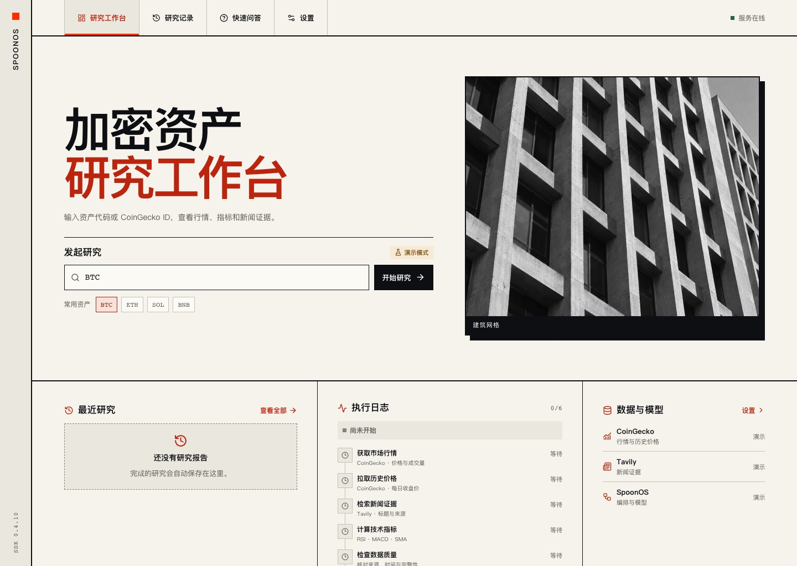

# SpoonOS Crypto Research

基于 SpoonOS SDK 的只读加密资产研究工作台。选择资产后，可以实时查看研究进度，核对行情、指标和证据，并基于已保存的快照追问。



## 快速启动

需要 Python 3.12、[uv](https://docs.astral.sh/uv/) 和 Node.js 22.12+（也支持 Node.js 20.19+ 的 20.x 版本）。在仓库根目录运行：

```bash
uv sync --locked --extra api
npm --prefix frontend ci
npm --prefix frontend run build
DEMO_MODE=true uv run --locked --extra api uvicorn service.app:create_app --factory --host 127.0.0.1 --port 8000
```

打开 [研究工作台](http://127.0.0.1:8000/)，选择 BTC 后点击「开始研究」。演示模式无需 API 密钥，使用固定示例行情，不请求外部数据源或模型。

也可直接通过 Docker Compose 启动，镜像会根据锁文件构建前端并安装 Python 依赖。

```bash
docker compose up --build -d
```

容器默认监听本机 8000 端口。未提供 `.env` 时使用演示模式。数据库存放在 `research-data` 卷。配置真实数据、变更端口和备份方式见 [部署说明](DEPLOYMENT.md)。

## 实际接入的能力

| 模块 | 实现与职责 |
|---|---|
| 快速问答 | `spoon_ai.agents.toolcall.ToolCallAgent` 执行 ReAct 循环，以结构化 function calls 调用工具 |
| 模型入口 | `spoon_ai.chat.ChatBot` 统一接入 OpenAI、Anthropic、DeepSeek、Gemini |
| 工具协议 | 行情、历史行情、新闻、指标、搜索均继承 `spoon_ai.tools.base.BaseTool`，由 `ToolManager` 注册 |
| 完整研究 | LangGraph 并行采集行情/历史/新闻，再计算指标、检查质量、用 SpoonOS 生成报告 |
| 数据来源 | CoinGecko USD 行情及每日价格采样；Tavily 新闻与网页检索 |
| 可追溯性 | Pydantic 校验报告与引用 ID；分别保存模型结论和 24h 涨跌幅规则信号 |
| 本地工作台 | React/TypeScript 前端查看行情、趋势、指标、证据、研究记录和服务配置 |
| 本地服务 | FastAPI 提供研究、问答和可重连的 SSE；SQLite 保存报告、数据快照和运行事件 |

项目锁定 **`spoon-ai-sdk==0.4.10`**，Python 导入名为 `spoon_ai`。相关接口见 [SpoonOS 源码](https://github.com/XSpoonAi/spoon-core)、[工具协议](https://github.com/XSpoonAi/spoon-core/blob/main/spoon_ai/tools/base.py)和 [ToolCallAgent](https://github.com/XSpoonAi/spoon-core/blob/main/spoon_ai/agents/toolcall.py)。

## 真实研究

```bash
cp .env.example .env
```

设置 `DEFAULT_LLM_PROVIDER` 并填入对应密钥。`DEFAULT_MODEL_NAME` 可留空。若需要新闻和网页检索，配置 `TAVILY_API_KEY`。CoinGecko 公共接口可无密钥运行。用上述本地命令启动时去掉 `DEMO_MODE=true`，或执行 `docker compose up -d` 让容器读取 `.env`。如果之前在工作台设置中手动选了「演示模式」，切换到「真实研究」或「跟随服务端」。

`requirements.txt` 仅引用 `pyproject.toml`；兼容 pip 的安装方式为 `python -m pip install -r requirements.txt`。要复现已验证的依赖组合，使用 `uv.lock`。SpoonOS 的依赖范围较宽，本项目固定了兼容的 FastMCP/MCP 并限制 Pydantic 版本，避免 SDK 导入失败。SDK 本身仍会安装一部分未使用的 Web3 依赖。

## Python 调用

```python
from dotenv import load_dotenv
from agents import CryptoAnalysisGraph, CryptoReActAgent

load_dotenv()
answer = CryptoReActAgent().run("BTC 当前价格是多少？请注明来源和时间。")
print(answer)

report = CryptoAnalysisGraph().run(symbol="BTC")
print(report.model_dump_json(indent=2))
```

异步服务或 notebook 中使用 `await agent.arun(...)`，同步 `run()` 会明确拒绝嵌套事件循环。每次问答创建独立 SpoonOS Agent 状态；`history` 保留 SDK 消息和工具调用记录，`reset()` 清除引用。工具同时提供 `run(**kwargs)` 和 SpoonOS 的 `await execute(**kwargs)`；同步 HTTP 在线程中执行。

模型运行时使用独立的 SpoonOS provider registry 与 manager，结束时关闭客户端，并逐请求传递选定模型名；这补齐了 SDK 0.4.10 默认共享实例、部分调用未转发模型名的行为，防止不同研究串用模型或跨事件循环复用连接。

兼容的交互式示例：

```bash
uv run python examples/react_demo.py
uv run python examples/graph_demo.py
```

## API 与 SSE

交互接口文档见 [FastAPI Swagger UI](http://127.0.0.1:8000/docs)。用以下命令创建演示任务并读取 SSE 事件。

```bash
curl -X POST http://127.0.0.1:8000/research/runs \
  -H 'Content-Type: application/json' -d '{"symbol":"BTC","demo_mode":true}'
# 把 <run_id> 换成上一步响应中的 run_id
curl -N 'http://127.0.0.1:8000/research/runs/<run_id>/events'
```

| 接口 | 用途 |
|---|---|
| `GET /health` | SDK 版本与服务存活检查；不代表外部连接可用 |
| `GET /settings` | 返回配置状态和默认研究模式；不返回密钥 |
| `POST /questions` | `{"question":"..."}`，SpoonOS 实时工具问答 |
| `POST /research` | 兼容接口：等待完整研究后返回已保存快照 |
| `POST /research/runs` | `202`，排队研究并返回 `run_id`；`demo_mode` 可选 |
| `GET /research/runs/{run_id}` | 读取排队、运行和终态 |
| `GET /research/runs/{run_id}/events` | SSE：`run`、`node`、`terminal`，支持事件续传 |
| `GET /research?limit=20&offset=0` | 分页读取已保存记录，可按 `symbol` 或 `status` 筛选 |
| `GET /research/{run_id}` | 读取原始报告、数据、证据和节点事件 |
| `POST /research/{run_id}/questions` | 针对原快照提问；不获取新行情 |

本地数据库默认位于 `outputs/research.sqlite3`，可用 `RESEARCH_DB_PATH` 修改。每次研究创建新的 `run_id` 和 `snapshot_id`。直接调用 Python Agent 时，如需持久化可使用 `service.store.ReportStore.save(report)`。

## 数据与结果契约

工具输出带 `status / source / fetched_at / updated_at / error`。当前实现的状态是 `live / mock / unavailable`，**没有缓存回退**。演示模式通过 `DEMO_MODE=true` 或工作台设置启用；使用固定演示行情与新闻，不伪造历史，不调用模型，也不生成投资方向。快速问答使用服务端配置，仍需要模型密钥。

完整研究遵守以下规则：

- 行情必须是有效正数且来源时间在最近 2 小时内；关键行情缺失时不生成模型结论。
- 采集暂时性网络错误、HTTP 429/5xx 最多重试一次；失败显示真实原因，不替换成固定价格。
- 新闻来源去重，保留链接和摘录；缺失的发布时间保持未知，并列入数据限制。不生成固定“Neutral”情绪分数。
- 每日历史采样须连续，至少 35 个有效样本，且最近采样距今不超过 48 小时。末尾不足一天的采样不参与指标计算。
- 指标为 Wilder RSI(14)、SMA(7/25/99)、SMA 初始化的 MACD(12/26/9)。不足 99 个样本时 `ma_99=null`。这些是每日价格采样指标，不是交易所 OHLC/K 线指标。
- JSON 格式、推荐枚举或引用 ID 校验失败时，`recommendation=null`，任务标记 `failed`。引用校验能检查 ID 是否存在，不能证明模型每一句解释都正确。
- `rule_signal` 只是 24h 涨跌幅阈值规则，`recommendation` 来自已校验的模型报告；二者分歧通过 `disagreement` 暴露。废弃字段 `confidence` 固定为 `null`，不再展示 75%。

报告状态：`completed`（所需数据齐全）、`partial`（有行情但存在证据缺口）、`unavailable`（关键行情缺失）、`failed`（报告失败）、`demo`（演示）。`limitations`、`evidence`、`data` 和带序号的 `events` 与报告一起保存。通知仅在显式 `notify=True` 时写控制台，失败不会重跑分析；模型没有交易、邮件或外部消息工具。

## 验证

前端开发可运行 `npm --prefix frontend run dev`。Vite 会将 API 和 SSE 转发到本机 8000 端口。开发页面在 [127.0.0.1:5173](http://127.0.0.1:5173/)。

```bash
uv run --locked --extra api --extra dev pytest -q
uv run --locked --extra api --extra dev ruff check agents tools service tests examples
npm --prefix frontend run build
```

默认测试不访问外部 HTTP、不产生模型费用。集成测试保留真实 SpoonOS `ChatBot → ToolCallAgent → ToolManager → BaseTool`，只替换外部推理边界。覆盖缺失数据、错误输出、未知引用、模型/规则分歧、指标计算、配置错误、持久化和快照追问。

## 当前边界

工作台面向本机单用户。关闭页面或断开 SSE 不会取消研究；刷新运行页面会重新读取状态和已有事件。进程重启后，未完成任务标记为中断，需要手动重新发起。当前不支持任务取消、图检查点、跨运行缓存、订阅和多人鉴权。公开部署需要补鉴权、限流和预算控制，见 [部署说明](DEPLOYMENT.md)。没有钱包或交易能力。

Apache-2.0，见 [LICENSE](LICENSE)。
